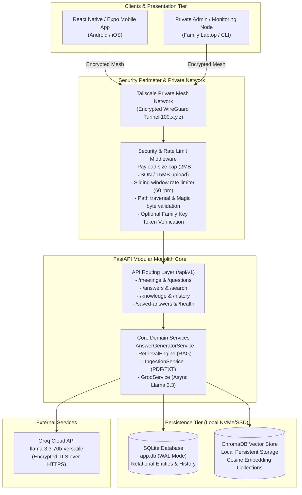
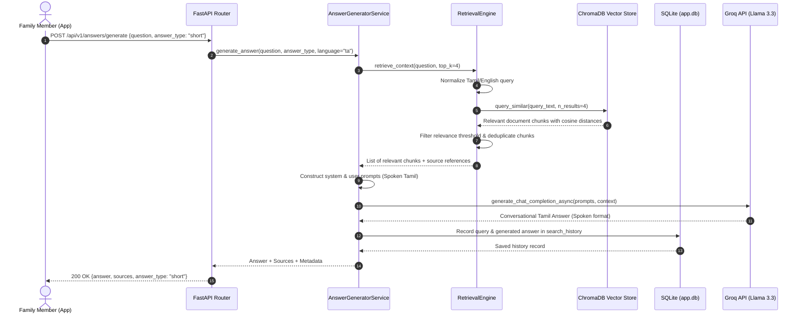
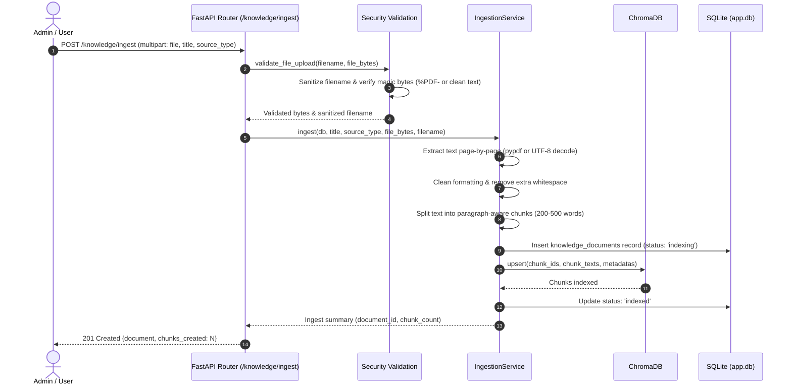

# JW Meeting Assistant - Backend Architecture & Technical Design

## 1. Executive Summary

**JW Meeting Assistant** is a private, family-centric mobile application and backend service designed to assist family members in preparing spoken, conversational Tamil answers for congregation meetings.

The backend is built as a **Modular Monolith** using **Python 3.11+**, **FastAPI**, **SQLite** (primary relational store in WAL mode), **ChromaDB** (embedded vector database), and **Groq Cloud API** (high-speed inference for Llama 3.3).

The service is intentionally architected for **private home-server deployment over a Tailscale mesh network**. It is not exposed directly to the public internet, requiring no complex public authentication UI while providing enterprise-grade security and reliability.

---

## 2. High-Level System Architecture



---

## 3. Component Architecture & Directory Structure

The backend adheres strictly to modular separation of concerns:

```
backend/
├── app/
│   ├── api/
│   │   └── routes/              # FastAPI APIRouter endpoints
│   │       ├── api.py           # Centralized router registry
│   │       ├── meetings.py      # Midweek and Weekend meeting endpoints
│   │       ├── questions.py     # Meeting section questions & reordering
│   │       ├── answers.py       # Meeting and independent question answer generation
│   │       ├── knowledge.py     # Document upload & text ingestion
│   │       ├── search.py        # Semantic vector search
│   │       ├── saved_answers.py # Curated family answers & personal notes
│   │       ├── history.py       # Search history & query logs
│   │       └── health.py        # System readiness & dependency probes
│   ├── core/                    # Core infrastructural settings
│   │   ├── config.py            # Pydantic Settings & environment variables
│   │   ├── exceptions.py        # Centralized exception handlers & error schemas
│   │   ├── logging.py           # Structured logging configuration
│   │   └── security.py          # Security, rate limiter, and validation middleware
│   ├── database/                # Database engine and ORM mappings
│   │   ├── connection.py        # SQLite engine, connection pool, WAL pragmas
│   │   └── crud.py              # Centralized transactional CRUD helpers
│   ├── models/                  # SQLAlchemy ORM declarative models
│   │   ├── meeting.py           # Meetings table
│   │   ├── question.py          # Questions table
│   │   ├── answer.py            # Generated answers table
│   │   ├── knowledge.py         # Ingested publications metadata
│   │   ├── saved_answer.py      # Family curated saved answers
│   │   ├── search.py            # Search query history
│   │   └── enums.py             # Meeting types, source categories, answer formats
│   ├── schemas/                 # Pydantic validation schemas (DTOs)
│   ├── services/                # Business logic and domain pipelines
│   │   ├── answer_generator.py  # Master RAG generation orchestrator
│   │   ├── retrieval.py         # Multi-lingual vector retrieval & deduplication
│   │   ├── ingestion.py         # PDF/TXT extraction, cleaning & chunking
│   │   ├── vector_store.py      # ChromaDB persistent client wrapper
│   │   ├── llm.py               # Groq LLM client with fallback handling
│   │   └── prompts.py           # Spoken conversational Tamil prompt templates
│   └── main.py                  # Application factory and lifespan manager
├── data/                        # Persistent local data
│   ├── app.db                   # SQLite primary database
│   └── chroma/                  # ChromaDB vector index files
├── deploy/                      # Production deployment artifacts
│   ├── jw-meetingmate.service   # Linux systemd hardened service
│   ├── gunicorn.conf.py         # Gunicorn process manager configuration
│   ├── backup.sh                # Automated backup script (WAL safe)
│   ├── restore.sh               # Automated disaster recovery restore script
│   └── logrotate.conf           # System log rotation policy
├── docs/                        # Complete technical documentation
└── tests/                       # Pytest automated test suite (106 tests)
```

---

## 4. End-to-End Data Flows

### A. RAG Answer Generation Pipeline



### B. Document Knowledge Ingestion Pipeline



---

## 5. Security & Isolation Perimeter

1. **Private Tailscale Mesh**:
   The server binds to `0.0.0.0` or directly to the Tailscale IP (`100.x.y.z`). It does not listen on public IPv4 addresses, avoiding public internet attack vectors and DDoS attempts.
2. **Rate Limiting**:
   In-memory sliding window limiter (default: 60 requests/minute per client IP) prevents runaway client retry loops and preserves Groq Cloud API tier limits.
3. **Payload Protection**:
   JSON payloads are capped at 2MB; file uploads are capped at 15MB. Oversized payloads are dropped with HTTP 413 without reading them into system RAM.
4. **Filesystem Defense**:
   Filenames are scrubbed against path traversal attempts (`../`, `..\`, null bytes). Magic bytes are verified before document extraction.
5. **No Credential Leakage**:
   In production (`APP_DEBUG=false`), unhandled exceptions return a standardized JSON error message without exposing database schema details, file paths, or stack traces.
6. **Optional Device Authorization**:
   `ENABLE_FAMILY_KEY_CHECK=true` requires all incoming requests to supply `X-Family-Token` or `X-API-Key`.
