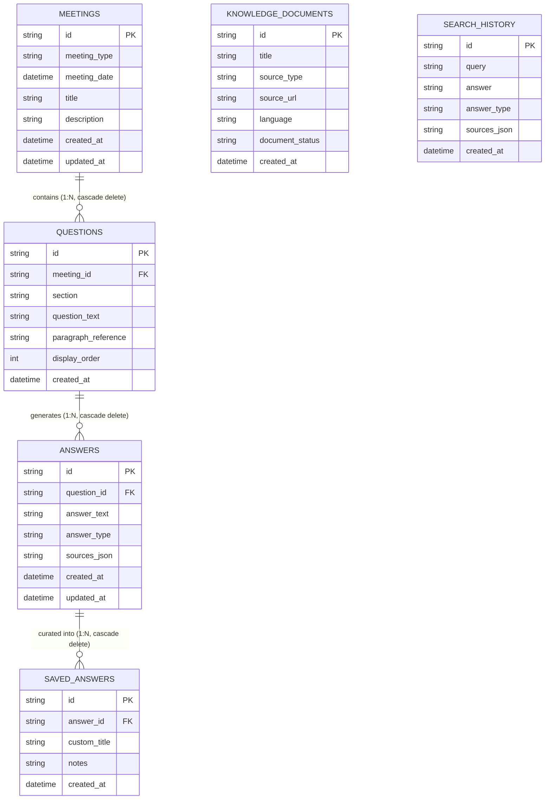

# JW Meeting Assistant - Database Schema & Data Models

## 1. Storage Overview

The primary relational database is **SQLite 3**, managed via **SQLAlchemy ORM**.

### Production Performance Pragmas
SQLite is configured with the following parameters on connection:
```sql
PRAGMA foreign_keys = ON;            -- Enforces foreign keys & cascades
PRAGMA journal_mode = WAL;           -- Write-Ahead Logging allows concurrent reads during writes
PRAGMA synchronous = NORMAL;         -- Ensures high throughput without risking corrupt transactions
PRAGMA cache_size = -64000;          -- Allocates 64 MB in-memory page cache
PRAGMA temp_store = MEMORY;          -- Stores intermediate sorting & temporary tables in RAM
PRAGMA busy_timeout = 5000;          -- 5-second wait on lock contention before throwing busy error
```

---

## 2. Entity-Relationship Diagram



---

## 3. Detailed Table Definitions

### 3.1 `meetings`
Stores scheduled midweek and weekend meeting sessions.

| Column | Type | Constraints | Description |
|---|---|---|---|
| `id` | `VARCHAR(36)` | PRIMARY KEY | UUID v4 identifier |
| `meeting_type` | `VARCHAR(20)` | NOT NULL, INDEX | Meeting category (`midweek`, `weekend`) |
| `meeting_date` | `DATETIME` | NOT NULL, INDEX | Scheduled date and time |
| `title` | `VARCHAR(255)` | NOT NULL | Meeting title |
| `description` | `TEXT` | NULLABLE | Optional program description |
| `created_at` | `DATETIME` | NOT NULL | Record creation timestamp |
| `updated_at` | `DATETIME` | NOT NULL | Record last updated timestamp |

**Indexes:**
- `ix_meetings_type_date` ON (`meeting_type`, `meeting_date`)
- `ix_meetings_meeting_type` ON (`meeting_type`)
- `ix_meetings_meeting_date` ON (`meeting_date`)

---

### 3.2 `questions`
Stores individual meeting questions categorized by section.

| Column | Type | Constraints | Description |
|---|---|---|---|
| `id` | `VARCHAR(36)` | PRIMARY KEY | UUID v4 identifier |
| `meeting_id` | `VARCHAR(36)` | NOT NULL, FK(`meetings.id` ON DELETE CASCADE), INDEX | Parent meeting reference |
| `section` | `VARCHAR(100)` | NOT NULL, INDEX | Meeting section (e.g. `பைபிள் புதையல்கள்`) |
| `question_text` | `TEXT` | NOT NULL | Full question text |
| `paragraph_reference` | `VARCHAR(100)` | NULLABLE | Associated paragraph / page |
| `display_order` | `INTEGER` | NOT NULL, DEFAULT 0 | Ordering index within meeting |
| `created_at` | `DATETIME` | NOT NULL | Creation timestamp |

**Indexes:**
- `ix_questions_meeting_order` ON (`meeting_id`, `display_order`)
- `ix_questions_meeting_id` ON (`meeting_id`)
- `ix_questions_section` ON (`section`)

---

### 3.3 `answers`
Stores generated, curated, or drafted answers for questions.

| Column | Type | Constraints | Description |
|---|---|---|---|
| `id` | `VARCHAR(36)` | PRIMARY KEY | UUID v4 identifier |
| `question_id` | `VARCHAR(36)` | NULLABLE, FK(`questions.id` ON DELETE CASCADE), INDEX | Optional parent question |
| `answer_text` | `TEXT` | NOT NULL | Natural conversational Tamil answer |
| `answer_type` | `VARCHAR(50)` | NOT NULL, DEFAULT 'short', INDEX | `short` (~30-50 words) or `detailed` |
| `sources_json` | `TEXT` | NULLABLE | JSON string of citation documents |
| `created_at` | `DATETIME` | NOT NULL | Creation timestamp |
| `updated_at` | `DATETIME` | NOT NULL | Update timestamp |

**Indexes:**
- `ix_answers_question_type` ON (`question_id`, `answer_type`)
- `ix_answers_question_id` ON (`question_id`)
- `ix_answers_answer_type` ON (`answer_type`)

---

### 3.4 `knowledge_documents`
Tracks metadata for reference publications indexed in ChromaDB.

| Column | Type | Constraints | Description |
|---|---|---|---|
| `id` | `VARCHAR(36)` | PRIMARY KEY | UUID v4 identifier |
| `title` | `VARCHAR(255)` | NOT NULL | Publication or document title |
| `source_type` | `VARCHAR(50)` | NOT NULL, INDEX | Category (`watchtower`, `awake`, `bible`, etc.) |
| `source_url` | `VARCHAR(1024)` | NULLABLE | Reference link on jw.org |
| `language` | `VARCHAR(10)` | NOT NULL, DEFAULT 'ta', INDEX | Language code |
| `document_status` | `VARCHAR(30)` | NOT NULL, DEFAULT 'pending', INDEX | Indexing status (`indexed`, `failed`, `pending`) |
| `created_at` | `DATETIME` | NOT NULL | Ingestion timestamp |

**Indexes:**
- `ix_knowledge_source_status` ON (`source_type`, `document_status`)

---

### 3.5 `saved_answers`
Stores family-curated answers with custom titles and personal study notes.

| Column | Type | Constraints | Description |
|---|---|---|---|
| `id` | `VARCHAR(36)` | PRIMARY KEY | UUID v4 identifier |
| `answer_id` | `VARCHAR(36)` | NOT NULL, FK(`answers.id` ON DELETE CASCADE), INDEX | Source answer reference |
| `custom_title` | `VARCHAR(255)` | NULLABLE | Custom user-friendly title |
| `notes` | `TEXT` | NULLABLE | Personal reflection or speaking notes |
| `created_at` | `DATETIME` | NOT NULL | Saved timestamp |

---

### 3.6 `search_history`
Maintains past queries, generated answers, and sources for quick recall and offline viewing.

| Column | Type | Constraints | Description |
|---|---|---|---|
| `id` | `VARCHAR(36)` | PRIMARY KEY | UUID v4 identifier |
| `query` | `TEXT` | NOT NULL | Tamil or English query prompt |
| `answer` | `TEXT` | NOT NULL | Generated response text |
| `answer_type` | `VARCHAR(50)` | NULLABLE, DEFAULT 'short' | Answer style |
| `sources_json` | `TEXT` | NULLABLE | Serialized sources array |
| `created_at` | `DATETIME` | NOT NULL, INDEX | Query execution timestamp |
